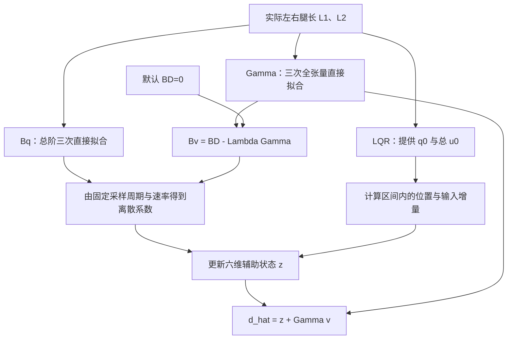
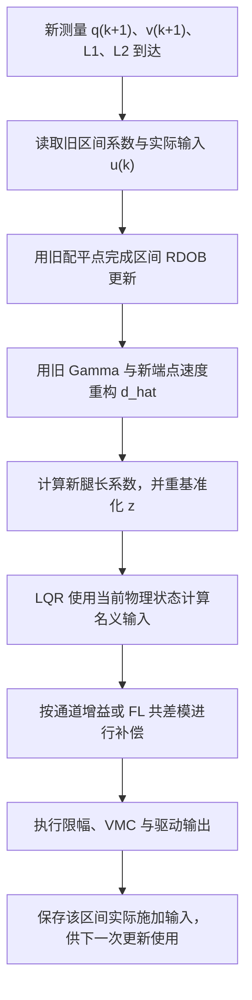

# 轮足机器人六阶输入等效降阶扰动观测器（RDOB）设计与实现专题文档

> **文档定位**：十四状态、六输入轮足机器人控制系统的扰动观测与补偿数学说明。  
> **核心算法**：输入等效 RDOB + 梯形离散更新 + Gamma 三次全张量与 Bq 总阶三次直接调度。  
> **基准控制器**：LQR 使用已有物理状态测量，RDOB 提供六路输入等效扰动估计。  
> **计算周期**：当前默认 1000 Hz，$T_s=0.001\,\mathrm{s}$。  
> **调度范围**：$L_1,L_2\in[0.18,0.38]\,\mathrm{m}$，平均腿长随两者变化。  
> **对应版本**：`RDOB` 分支，0.5% 矩阵与 1% 通道映射预算版本；记录日期 2026-09-21。

## 五个数学对象速查

“五个矩阵”具体是**三个 $6\times7$ 增益矩阵和两个配平列向量**。它们都由实际左右腿长决定，但承担不同任务。当前 RDOB 仅调度 `gamma` 与 `position_gain`；两个配平向量复用既有 LQR 调度结果，默认零阻尼不导出 `damping_gain`。

| 调度对象 | 数学定义 | 维度 | 主要作用 |
| :--- | :--- | :--- | :--- |
| `gamma` | $\Gamma=\Lambda S_0^\dagger M_0$ | $6\times7$ | 将可测速度映射到扰动重构坐标，使加速度能从观测器更新中消去 |
| `position_gain` | $B_q=\Lambda S_0^\dagger K_0$ | $6\times7$ | 在观测器中计入位置偏离配平点所对应的已知广义力变化 |
| `damping_gain` | $B_D=\Lambda S_0^\dagger D_0$ | $6\times7$ | 在观测器中计入名义速度阻尼；默认 $D_0=0$ 时整个矩阵为零 |
| `trim_position` | $q_0(L_1,L_2)$ | $7\times1$ | 定义当前位置增量的零点：$\delta q=q-q_0$ |
| `trim_total_input` | $u_0(L_1,L_2)$ | $6\times1$ | 定义实际总输入增量的零点：$\delta u=u_{\mathrm{applied}}-u_0$ |

五个对象在两条方程中的位置如下，其中静态配平速度为零，$v=\delta\dot q=\dot q$：

$$
\boxed{\hat d_u=z+\Gamma v}
$$

$$
\boxed{\dot z=-\Lambda\hat d_u+B_q(q-q_0)+B_Dv-\Lambda(u_{\mathrm{applied}}-u_0)}.
$$

当前导出不再使用 `Mean`、`Modes`、`Coefficients` POD 表示，而是直接导出每个矩阵元素的固定多项式系数。

---

## 一、六阶 RDOB 的观测目标

### 1.1 现有控制链需要观测什么

设七个广义坐标及七个广义速度均可获得。LQR 已经使用这些状态信号进行反馈，额外需要的是执行器输入端的六路未知扰动。

十四个物理状态已经由现有测量与融合链提供给 LQR，因此扰动观测器不再重复维护一套物理状态估计。RDOB 直接利用可测位置和速度，只维护六个辅助状态：

$$z\in\mathbb R^6.$$

十四个测量信号仍参与运算。上一时刻测量缓存、补偿滤波器和控制器状态的存储，应另外计算。

| 项目 | RDOB 设计选择 |
| :--- | :--- |
| 核心内部状态 | 六维辅助变量 $z$ |
| 状态信息来源 | 已有位置、速度测量 |
| 扰动输出 | $\hat d_u=z+\Gamma v$ |
| 主要整定量 | 六个扰动收敛速率 $\lambda_i$ |
| 需要验证的重点 | 速度测量质量、模型投影、输入时序与补偿动态 |

减少观测器阶数并不自动保证更低噪声或更好的闭环鲁棒性。RDOB 的价值是让内部结构与“只估计输入等效扰动”的任务直接对应。

### 1.2 观测六路与补偿四路是独立选择

六路扰动始终按以下顺序估计：

$$
d_u=\begin{bmatrix}
d_{Tw1}&d_{Tw2}&d_{Tp1}&d_{Tp2}&d_{FL1}&d_{FL2}
\end{bmatrix}^{\!T}.
$$

如果控制上只使用 Tw+FL 补偿，可在观测器外设置

$$
C_{\mathrm{comp}}=\operatorname{diag}(g_w,g_w,0,0,g_F,g_F).
$$

将 $C_{\mathrm{comp}}$ 用于补偿输出，而不乘入 RDOB 更新方程。Tp 仍可作为独立输入方向参与扰动解释。

---

## 二、轮足动力学与输入等效扰动的数学建模

### 2.1 状态、输入和坐标顺序

本项目使用

$$
q=\begin{bmatrix}x&\psi&\theta&\phi&\bar L&\beta_1&\beta_2\end{bmatrix}^{\!T},
\qquad v=\dot q.
$$

其中 $\psi$ 为航向角，$\theta$ 为机体俯仰角，$\phi$ 为机体横滚角，$\beta_1,\beta_2$ 为两腿摆角。其命名遵循当前十四状态模型。

输入为

$$
u=\begin{bmatrix}T_{w1}&T_{w2}&T_{p1}&T_{p2}&F_{L1}&F_{L2}\end{bmatrix}^{\!T}.
$$

前四个输入的单位为 $\mathrm{N\cdot m}$，后两个为 $\mathrm N$。位置与速度向量混合了平移和转动坐标，因此不能给整个 $M_0$ 或 $\Gamma$ 指定一个统一的标量单位；应按行列对应的物理量检查量纲。

从交错排列的十四状态向量中提取时，Python 使用 `q=state[0::2]`、`v=state[1::2]`。RDOB 的矩阵列顺序是上述七坐标顺序。

### 2.2 固定配平点的增量动力学

在一个固定的 $(L_1,L_2)$ 配平点，定义

$$\delta q=q-q_0,\qquad \delta\dot q=v,\qquad
\delta u=u_{\mathrm{applied}}-u_0.$$

线性化动力学为

$$
\boxed{M_0\dot v+D_0v+K_0\delta q=S_0(\delta u+d_u)}.
$$

- $M_0\in\mathbb R^{7\times7}$：配平点质量矩阵。
- $D_0\in\mathbb R^{7\times7}$：名义速度阻尼矩阵，当前默认取零。
- $K_0\in\mathbb R^{7\times7}$：线性化位置相关广义力矩阵。
- $S_0\in\mathbb R^{7\times6}$：输入到广义力的映射，列满秩。

当前代码的 $K_0$ 来自静态残差对位置的导数。对于静态残差 $g(q)-S(q)u_0$，有

$$K_0=\left.\frac{\partial\bigl(g(q)-S(q)u_0\bigr)}{\partial q}\right|_{q_0}.$$

因此，$K_0$ 包含重力和输入几何变化的线性化影响；不能仅按机械弹簧刚度理解。它也不同于 LQR 的状态反馈矩阵，本文将后者记为 $K_{\mathrm{LQR}}$。

### 2.3 为什么使用输入矩阵的左伪逆

由于 $\operatorname{rank}(S_0)=6$，存在欧氏左伪逆

$$S_0^\dagger=(S_0^TS_0)^{-1}S_0^T,\qquad S_0^\dagger S_0=I_6.$$

对动力学左乘 $S_0^\dagger$，得到

$$S_0^\dagger M_0\dot v+S_0^\dagger D_0v+S_0^\dagger K_0\delta q
=\delta u+d_u.$$

于是未知扰动被统一表示在六个执行器输入坐标中。数值实现通过 SVD 计算左伪逆，避免显式求逆正规方程；若给定容差下列秩不足，生成器会拒绝设计。

### 2.4 非匹配扰动的投影边界

若另有广义外力 $f\in\mathbb R^7$，则

$$M_0\dot v+D_0v+K_0\delta q=S_0(\delta u+d_u)+f.$$

定义

$$P_{\parallel}=S_0S_0^\dagger,\qquad P_{\perp}=I_7-P_{\parallel}.$$

任意广义力可分解为

$$f=P_{\parallel}f+P_{\perp}f,\qquad S_0^\dagger P_{\perp}f=0.$$

左伪逆消去的是 $\ker(S_0^T)$ 中的正交分量。该空间在本模型中为一维，通常不等于某个固定坐标轴。一般非匹配外力仍可能具有非零的输入空间投影，并被估计为 $S_0^\dagger f$。

被投影消去不意味着该外力对机器人运动没有影响。这里的正交性也依赖所采用的广义力坐标和尺度。

---

## 三、消去加速度的连续 RDOB 推导

### 3.1 从直接逆动力学估计出发

如果加速度能够准确获得，可以定义瞬时模型残差

$$r_u=S_0^\dagger(M_0\dot v+D_0v+K_0\delta q)-\delta u.$$

在理想匹配模型下 $r_u=d_u$。为了抑制高频残差并调节收敛速度，构造一阶滤波估计

$$\dot{\hat d}_u=\Lambda(r_u-\hat d_u),\qquad
\Lambda=\operatorname{diag}(\lambda_1,\ldots,\lambda_6),\quad\lambda_i>0.$$

将 $r_u$ 展开：

$$
\dot{\hat d}_u=
\Lambda S_0^\dagger M_0\dot v
+\Lambda S_0^\dagger D_0v
+\Lambda S_0^\dagger K_0\delta q
-\Lambda\delta u-\Lambda\hat d_u.
$$

此时方程仍含有 $\dot v$，直接使用速度差分会引入加速度噪声。

### 3.2 引入辅助状态

定义

$$\boxed{\Gamma=\Lambda S_0^\dagger M_0},\qquad
\boxed{z=\hat d_u-\Gamma v}.$$

在固定配平点，$\Gamma$ 为常矩阵，因此

$$\dot z=\dot{\hat d}_u-\Gamma\dot v.$$

代入上一节方程，两个加速度项严格相消：

$$
\begin{aligned}
\dot z
&=\underbrace{\Lambda S_0^\dagger M_0\dot v-\Gamma\dot v}_{0}
+\Lambda S_0^\dagger D_0v+\Lambda S_0^\dagger K_0\delta q
-\Lambda\delta u-\Lambda\hat d_u\\
&=-\Lambda(z+\Gamma v)
+\Lambda S_0^\dagger D_0v+\Lambda S_0^\dagger K_0\delta q-\Lambda\delta u.
\end{aligned}
$$

最终得到只依赖位置、速度和实际输入的六维观测器：

$$
\boxed{\dot z=-\Lambda z+
\bigl(\Lambda S_0^\dagger D_0-\Lambda\Gamma\bigr)v
+\Lambda S_0^\dagger K_0\delta q-\Lambda\delta u}
$$

$$\boxed{\hat d_u=z+\Gamma v}.$$

这里的 $z$ 是内部辅助坐标，不能直接当成扰动力矩或腿力输出；重构后的 $\hat d_u$ 才是供补偿使用的输入等效扰动。

### 3.3 误差动力学与收敛条件

将真实动力学重新代入观测器，可得

$$\dot{\hat d}_u=\Lambda(d_u-\hat d_u).$$

定义估计误差 $e=d_u-\hat d_u$，则

$$\boxed{\dot e=\dot d_u-\Lambda e}.$$

若扰动恒定，$\dot d_u=0$：

$$e_i(t)=e_i(0)e^{-\lambda_i t}.$$

若扰动变化率满足 $|\dot d_{u,i}(t)|\le w_i$，由误差方程的积分解可得

$$|e_i(t)|\le e^{-\lambda_i t}|e_i(0)|+
\frac{w_i}{\lambda_i}\bigl(1-e^{-\lambda_i t}\bigr).$$

提高 $\lambda_i$ 可以减小理想模型下的缓变扰动跟踪误差，但会改变噪声敏感度。未知广义外力存在时，理想观测目标变为 $d_u+S_0^\dagger f$。

### 3.4 带宽、时间常数与单位

命令行参数使用 Hz，连续方程使用收敛速率：

$$\lambda_i=2\pi f_i,\qquad \tau_i=\frac1{\lambda_i}.$$

当前默认值按 RDOB 的梯形离散公式反算，使 $T_s=1\,\mathrm{ms}$ 时六路名义离散极点都等于 $0.992$。表中的 95% 收敛时间对应理想连续一阶阶跃响应，由 $t_{95}=-\ln(0.05)/\lambda_i$ 计算，不是实车测量结果。

| 通道 | $f_i$ | $\lambda_i$ | 时间常数 | 理想 95% 收敛时间 |
| :--- | ---: | ---: | ---: | ---: |
| 全部六路 | 1.278353 Hz | 8.032129 s⁻¹ | 124.5 ms | 372.9 ms |

该带宽只定义名义扰动收敛速度，不保证实际闭环的冲激响应或全部瞬态；仍需结合传感器与执行器动态整定。

---

## 四、五个调度对象的物理含义与代码对应

### 4.1 `gamma`：速度到扰动重构坐标的映射

$$\Gamma=\Lambda S_0^\dagger M_0.$$

乘积 $M_0v$ 可按固定质量矩阵下的广义动量理解。$S_0^\dagger$ 将其投影到输入坐标，$\Lambda$ 再引入观测速率。$\Gamma v$ 与 $z$ 相加，恢复六路扰动估计。

它同时承担三项任务：

1. 在连续推导中消去加速度；
2. 通过 $-\Lambda\Gamma v$ 参与辅助状态更新；
3. 在重构、初始化和系数切换时完成 $z\leftrightarrow\hat d_u$ 的坐标变换。

即使机器人仅因已知控制输入而加速，$\Gamma v$ 也可能非零。此时 $z$ 会与之配合，使 $\hat d_u$ 保持正确；不能把 $\Gamma v$ 单独当成外力估计。

其关键代数关系为

$$\Gamma M_0^{-1}S_0=\Lambda.$$

这也是拟合后要单独验证输入通道映射的原因。

### 4.2 `position_gain`：已知位置相关广义力项

$$B_q=\Lambda S_0^\dagger K_0.$$

当位置偏离线性化配平点时，模型中的 $K_0\delta q$ 表示已知的广义力变化。观测器通过 $B_q\delta q$ 计入这部分作用，使运动引起的已知模型变化与未知输入扰动得到区分。

该矩阵属于观测器，不直接决定 LQR 的位置反馈强度。其项在 $\dot z$ 中为正号，是因为在求解输入残差时，$K_0\delta q$ 与惯性、阻尼项一起位于动力学等式左侧。

当已知 $K_0$ 非零却在观测器中忽略它时，相应位置变化可能进入扰动估计。反之，如果模型中某些位置方向确实没有该作用，相应列自然为零。

### 4.3 `damping_gain`：名义阻尼的输入等效映射

$$B_D=\Lambda S_0^\dagger D_0.$$

它对应的是动力学中预先建模的速度阻尼。当前默认 $D_0=0$，因此

$$B_D=0.$$

这解释了早期头文件中 `kDampingGainMean`、`kDampingGainModes` 和 `kDampingGainCoefficients` 全零的原因。当前导出器已经消去了该完整零块的 C++ 存储和求值。

**阻尼增益为零时，观测器的总速度系数仍然存在：**

$$\boxed{B_v=B_D-\Lambda\Gamma=-\Lambda\Gamma\quad(D_0=0)}.$$

所以不能因 `damping_gain` 为零而删除所有速度运算。当前 `velocity_gain` 就是重构出的 $B_v$，它不属于五个独立拟合对象。

另外，$D_0=0$ 只描述当前名义模型，没有断言机器人不存在摩擦或阻尼。未建模阻力可能作为模型残差进入等效扰动估计。

### 4.4 `trim_position`：线性化坐标原点

$$q_0=q_0(L_1,L_2),\qquad\delta q=q-q_0.$$

当前静态配平模型给出

$$q_0=\begin{bmatrix}
0&0&0&0&\dfrac{L_1+L_2}{2}&\beta_{1,0}(L_1)&\beta_{2,0}(L_2)
\end{bmatrix}^{\!T}.$$

两腿配平摆角由质心模型求得。不同腿长对应不同的线性化坐标原点。

配平点和跟踪目标承担不同职责：$q_0$ 用于构造局部动力学增量，LQR 的 $q_{\mathrm{ref}}$ 用于定义控制目标。把当前状态直接当作 $\delta q$ 使用，会将基准位置也乘入 $B_q$，产生错误的观测器输入项。

### 4.5 `trim_total_input`：维持名义配平的总输入

$$u_0=u_0(L_1,L_2),\qquad\delta u=u_{\mathrm{applied}}-u_0.$$

静态配平要求名义输入与重力相平衡，当前模型通过求解并检查

$$S(q_0)u_0-g(q_0)=0$$

得到该向量。

以腿力为例，机器人在无外扰的静止配平状态下也需要支撑力。$u_0$ 用于把这部分名义输入从增量模型中扣除，使 RDOB 估计的是配平之外的未知偏差。

`total` 表示总广义输入。若下位机提供的是主动电机折算腿力，则应按一致的模型约定构造

$$F_{L,\mathrm{total}}=F_{L,\mathrm{active}}+F_{\mathrm{gas,model}}(L),$$

再减去 $F_{L,0,\mathrm{total}}$。主动前馈力和总配平力不能混用；气弹簧模型误差会进入残差。

### 4.6 五个对象与派生系数的关系



| 数学量 | 上位机字段 | C++ 调度输出或常量 | 是否独立拟合 |
| :--- | :--- | :--- | :--- |
| $\Gamma$ | `gamma` | `kGammaCoefficients`，调用者求值得到 `gamma[6][7]` | 是，三次全张量直接拟合 |
| $B_q$ | `position_gain` | `kPositionGainCoefficients`，调用者求值得到 `bq[6][5]` | 是，总阶三次直接拟合；前两列固定零 |
| $B_D$ | `damping_gain` | 非零阻尼时的 `kDampingGainCoefficients` | 仅非零阻尼时；默认零块被消去 |
| $q_0$ | LQR `trim_position` | RDOB 调用者提供 | 否，复用 LQR |
| $u_0$ | LQR `trim_total_input` | RDOB 调用者提供 | 否，复用 LQR |
| $B_v$ | `velocity_gain` | 默认不物化；由 $B_D-\Lambda\Gamma$ 得到 | 否 |
| $A_z$ 对角线 | `step_poles` | `kStepPoles[6]` | 固定值，六路分别离线预计算 |
| $C_q$ | `step_position_gain` | `kStepEndpointWeight[i]*Bq[i][j]` | 否 |
| $C_v$ | `step_velocity_gain` | `D=0` 时为 `kStepVelocityScale[i]*Gamma[i][j]` | 否 |
| $C_u$ 对角线 | `step_input_gain` | `kStepInputGain[6]` | 固定值，六路分别离线预计算 |

---

## 五、离散更新与 L1/L2 调度的数学处理

### 5.1 对辅助状态方程进行梯形积分

把连续方程记为

$$\dot z=-\Lambda z+B_q\delta q+B_vv-\Lambda\delta u.$$

设区间 $[t_k,t_{k+1})$ 内使用固定系数，实际输入增量 $\delta u_k$ 在该区间保持。令 $h=T_s$，梯形积分给出

$$
\begin{aligned}
z_{k+1}=z_k+\frac h2\big[&-\Lambda(z_k+z_{k+1})
+B_q(\delta q_k+\delta q_{k+1})\\
&+B_v(v_k+v_{k+1})-2\Lambda\delta u_k\big].
\end{aligned}
$$

将未知的 $z_{k+1}$ 移至左侧，定义

$$R_h=\left(I_6+\frac h2\Lambda\right)^{-1},$$

$$A_z=R_h\left(I_6-\frac h2\Lambda\right),\qquad
C_q=\frac h2R_hB_q,\qquad C_v=\frac h2R_hB_v,\qquad C_u=-hR_h\Lambda.$$

得到可直接实现的更新式：

$$\boxed{z_{k+1}=A_zz_k+C_q(\delta q_k+\delta q_{k+1})
+C_v(v_k+v_{k+1})+C_u\delta u_k}$$

$$\boxed{\hat d_{u,k+1}=z_{k+1}+\Gamma v_{k+1}}.$$

$R_h$、$A_z$、$C_u$ 均为对角矩阵，不需要运行时通用矩阵求逆。当前实现将其相关六个对角系数及端点权重离线预计算。

### 5.2 离散极点及其适用范围

辅助状态齐次更新的极点为

$$p_i=\frac{1-h\lambda_i/2}{1+h\lambda_i/2}.$$

对有限正数 $h,\lambda_i$，有 $|p_i|<1$。若 $h\lambda_i>2$，则 $p_i<0$，数值响应逐采样交替，因此数值稳定不等于带宽选择合适。

本式是连续 $z$ 方程的梯形数值离散化，不是机器人与观测器联合系统的精确零阶保持离散化。只有在相应理想假设或离散模型一致性条件下，才能进一步将其解释为采样误差的精确极点。当前测试通过独立的精确植物离散化检查数值步长收敛性。

### 5.3 为什么旧区间内不能直接换成新系数

观测器变量 $z=\hat d_u-\Gamma v$ 的定义依赖 $\Gamma$。若在同一物理状态下直接换成 $\Gamma^+$，但保持 $z$ 不变，就会得到

$$\hat d_u^+-\hat d_u^-=(\Gamma^+-\Gamma^-)v.$$

这是一种坐标变换引起的输出突跳，与真实扰动变化无关。

若要连续处理时变 $\Gamma(t)$，对辅助变量求导还会出现 $-\dot\Gamma v$；变化配平点也引入相应坐标项。当前实现采用分段固定模型和端点重基准化：

1. 使用旧 $(L_{1,k},L_{2,k})$ 的系数完成区间 $[t_k,t_{k+1})$ 更新；
2. 两个位置端点都减旧 $q_{0,k}$，实际区间输入减旧 $u_{0,k}$；
3. 用旧 $\Gamma_k$ 与新端点速度重构 $\hat d_{u,k+1}^-$；
4. 求出新腿长对应的 $\Gamma_{k+1}$，设置

$$\boxed{z_{k+1}^+=\hat d_{u,k+1}^--\Gamma_{k+1}v_{k+1}}.$$

于是

$$z_{k+1}^++\Gamma_{k+1}v_{k+1}=\hat d_{u,k+1}^-.$$

扰动重构值在切换瞬间保持连续。这个处理解决代数坐标突跳，不构成任意快速变腿长过程的稳定性证明。

### 5.4 初始化

给定希望的初始扰动估计 $\hat d_{u,0}$，应设置

$$z_0=\hat d_{u,0}-\Gamma v_0.$$

零扰动初始化对应 $z_0=-\Gamma v_0$。仅在 $\Gamma v_0=0$ 时，直接清零 $z_0$ 才产生零扰动输出。

---

## 六、直接多项式离线拟合与压缩

### 6.1 二维参数域与快照

实际左右腿长独立变化：

$$L_1,L_2\in[0.18,0.38]\,\mathrm m,\qquad\bar L=(L_1+L_2)/2.$$

对每个节点分别计算配平值、动力学矩阵和观测器增益。相同 $\Delta L$、不同 $\bar L$ 的两组腿长，一般对应不同的系数。

默认网格步长为 0.02 m，共有 $11\times11=121$ 个训练点。验证还包括 100 个单元中点、40 个边界中点和固定种子的 24 个随机点，共 164 个留出点。

### 6.2 Gamma 三次全张量直接拟合

将两个腿长分别映射为

$$\xi_i=2\frac{L_i-L_{\min}}{L_{\max}-L_{\min}}-1,\qquad i=1,2.$$

只归一化参数坐标，状态与输入仍使用原来的 SI 坐标。对 Gamma 的每个元素直接拟合

$$\widehat\Gamma_{ab}(L_1,L_2)=
\sum_{i=0}^{3}\sum_{j=0}^{3}c^{\Gamma}_{ab,ij}\xi_1^i\xi_2^j.$$

每个元素有 $4\times4=16$ 个系数。运行时采用嵌套 Horner：每个 Gamma 元素需要 15 次乘法，而不需要在线 SVD、Chebyshev 递推、伪逆或三角函数。

### 6.3 Bq 总阶三次直接拟合

由模型验证，$B_q$ 的前两列在完整训练和留出集上严格为零，导出器保持这两个零列而不存储或求值。其余 $6\times5=30$ 个元素使用

$$\widehat B_{q,ab}(L_1,L_2)=
\sum_{i+j\le3}c^{B_q}_{ab,ij}\xi_1^i\xi_2^j.$$

每个非零元素有 10 个系数，以三角嵌套 Horner 求值时需要 9 次乘法。

### 6.4 LQR 复用配平量与误差预算

$q_0$ 与总 $u_0$ 仍是观测器方程的数学对象，但现在由已有 LQR 调度路径提供。生成头文件不定义运行时 `Coefficients` 结构；调用 `step_scheduled_rdob` 时传入刚结束区间的 LQR `q0` 和总 `u0`。

对每个矩阵、每个验证点定义

$$\varepsilon_F=\frac{\|\widehat F-F\|_F}{\|F\|_F}.$$

默认要求最大值不超过 $0.005=0.5\%$，并使用模拟 C++ 运算顺序的 float32 结果验证。这是矩阵整体误差，不是每个元素的相对误差；结构零块单独验证，不用除以零。

由于各物理通道的量级不同，整体范数可能掩盖某些敏感方向。对 $\Gamma$ 再增加输入映射约束：

$$\varepsilon_{\mathrm{channel}}=
\frac{\|\widehat\Gamma M_0^{-1}S_0-\Lambda\|_F}{\|\Lambda\|_F}
\le0.01.$$

通道映射约束比矩阵误差放宽为 1%，仍以整个映射矩阵的范数验收，不是逐通道逐元素保证。

当前默认浮点验证结果为 Gamma 约 0.01990%、Bq 约 0.20939%、通道映射约 0.51837%。

### 6.5 全零阻尼为何可以整体删除

当 $D_0=0$ 时，理论上 $B_D=0$ 对全参数域成立。生成器在训练和留出点验证该固定结构，再删除 C++ 中的整个阻尼块。

JSON/NPZ 仍可保留零块作为离线数据说明。非零阻尼配置会生成完整的阻尼路径。若假设为零却出现非零拟合矩阵，导出器会报错，而不会静默抹去模型耦合。

---

## 七、实时补偿流程与 C++ 对应实现

### 7.1 观测器输入和补偿输出的时序



RDOB 的输入应包含补偿后的实际作用，并与刚结束的采样区间对应。使用未限幅指令、错误的输入符号或错一拍的输入，都可能被观测器解释为未知扰动。

### 7.2 LQR 与输入等效补偿

在一致的总输入坐标下，可写为

$$u_{\mathrm{nom}}=u_0-K_{\mathrm{LQR}}(x-x_{\mathrm{ref}}),\qquad
u_{\mathrm{cmd}}=u_{\mathrm{nom}}-C_{\mathrm{comp}}\hat d_u.$$

扰动已经折算到执行器输入单位，直接按同一单位相减。若估计 $\hat d_i>0$，表示模型输入方向上有正向附加作用，补偿项取负方向。

FL 可以进一步分为共模与差模：

$$\hat d_{F,+}=\frac{\hat d_{FL1}+\hat d_{FL2}}2,\qquad
\hat d_{F,-}=\frac{\hat d_{FL1}-\hat d_{FL2}}2.$$

对应两腿补偿量为

$$\Delta F_{L1}=g_+\hat d_{F,+}+g_-\hat d_{F,-},\qquad
\Delta F_{L2}=g_+\hat d_{F,+}-g_-\hat d_{F,-}.$$

这里的 $\Delta F_{Li}$ 表示待扣除的估计补偿量，实际指令为 $F_{Li,\mathrm{cmd}}=F_{Li,\mathrm{nom}}-\Delta F_{Li}$。

在近似对称、双轮稳定接触地面的工况下，共模主要影响整体支撑，差模主要影响左右支撑分配与横滚。实际耦合仍由完整动力学决定。

### 7.3 与生成头文件一致的 C++ 示例

`rdob_schedule.h` 是纯数据头文件，只导出腿长范围、采样周期、六通道离散常量和多项式系数表。它不定义 `Coefficients` 结构，也不提供 `evaluate()`；腿长检查、归一化和多项式求值由固件自己的函数完成。固件只需保存求值后的 `gamma[6][7]` 与 `bq[6][5]`。

默认零阻尼路径的区间更新可按下面的循环组织：

```cpp
#include "rdob_schedule.h"

namespace rdob_example {
inline void advance_interval(
    const float gamma[6][7], const float bq[6][5], float z[6],
    const float dq_prev[7], const float dv_prev[7],
    const float du_applied[6],
    const float dq_now[7], const float dv_now[7], float d_now[6]) {
    float next_z[6];
    for (unsigned i = 0; i < 6; ++i) {
        float bq_q_sum = 0.0f;
        float gamma_v_sum = 0.0f;
        for (unsigned j = 2; j < 7; ++j)
            bq_q_sum += bq[i][j-2]*(dq_prev[j]+dq_now[j]);
        for (unsigned j = 0; j < 7; ++j) {
            gamma_v_sum += gamma[i][j]*(dv_prev[j]+dv_now[j]);
        }
        next_z[i] = wheel_leg_rdob_schedule::kStepPoles[i]*z[i]
            + wheel_leg_rdob_schedule::kStepEndpointWeight[i]*bq_q_sum
            + wheel_leg_rdob_schedule::kStepVelocityScale[i]*gamma_v_sum
            + wheel_leg_rdob_schedule::kStepInputGain[i]*du_applied[i];
        d_now[i] = next_z[i];
        for (unsigned j = 0; j < 7; ++j)
            d_now[i] += gamma[i][j]*dv_now[j];
    }
    for (unsigned i = 0; i < 6; ++i) z[i] = next_z[i];
}
} // namespace rdob_example
```

上式中的 `gamma/bq` 必须是刚结束区间冻结的旧矩阵。完成更新和扰动限幅后，固件才计算新腿长对应的矩阵，并以 $z=\hat d_u-\Gamma_{new}v$ 重基准化。上位机的 `step_scheduled_rdob` 实现相同的区间划分。

### 7.4 上位机生成命令与文件

```powershell
python run_rdob.py --step 0.02 --fit-tolerance 0.005 --channel-tolerance 0.01 --output-dir data/generated/rdob
```

Gamma 固定使用三次全张量、Bq 固定使用总阶三次；单点诊断使用 `--mode node --l1 ... --l2 ...`。

| 文件 | 内容 |
| :--- | :--- |
| `rdob_schedule.npz` | 参数点、直接多项式系数与六通道离散常量 |
| `rdob_schedule.json` | 同一组数据及单位、误差定义、搜索过程和数值诊断 |
| `rdob_schedule.h` | C++11 float32 纯数据表；不含结构体或求值函数 |
| `rdob_schedule_report.md` | 拟合精度、下游检查、存储和运算量说明 |

---

## 八、数值验证、调试依据与工程边界

### 8.1 当前版本的离线结果

以下来自当前生成报告，属于离线计算结果，不是实车抗扰性能。Gamma 使用每元素 16 项三次全张量，Bq 的 30 个非零元素各使用 10 项总阶三次。

| 调度对象 | 直接多项式 | float32 最大矩阵相对误差 |
| :--- | ---: | ---: |
| $\Gamma$ | 三次全张量 | 0.0198982% |
| $B_q$ | 总阶三次 | 0.209390% |
| $B_D$ | 默认零块 | 0%，默认 C++ 路径已消去 |
| $q_0$ | LQR 复用 | 不在 RDOB 中重复拟合 |
| $u_0$ | LQR 复用 | 不在 RDOB 中重复拟合 |

其他验证结果：

- 121 个训练点、164 个留出点；
- 匹配输入通道映射最大相对误差约 0.518365%；
- 拟合系数对应的冻结点补偿闭环最大谱半径约 0.998479；
- 检查了 Tw+FL 全增益补偿与全部六路全增益补偿；
- 当前纯数据接口下，`Gamma/Bq` 求值上界约为 904 次乘法、904 次加减法；默认浮点系数与六通道常量共 4020 B；
- 自动化测试覆盖连续扰动收敛、离散步长收敛、六路独立带宽常量、系数重基准化及零/非零阻尼的 float32 数据契约。

这些误差上限针对已计算的验证点，不是对整个连续参数域的严格解析上界。冻结点闭环使用精确局部 LQR 和无噪声、无延迟、无饱和模型，也不代替实机或拟合 LQR 的联合验证。

### 8.2 为什么没有加速度求导仍然可能放大噪声

在固定模型、零初始条件下，若位置和速度测量分别包含噪声 $n_q,n_v$，可从连续方程得到噪声到扰动输出的关系：

$$\Delta\hat d_u(s)=
(sI_6+\Lambda)^{-1}B_qn_q(s)
+(sI_6+\Lambda)^{-1}(s\Gamma+B_D)n_v(s).$$

速度噪声通道在高频下趋向 $\Gamma$，说明重构项会直接传递一部分速度噪声。降低阶数不等于消除了这一问题；应结合已有速度融合、带宽和补偿滤波检查实际输出。

### 8.3 常见现象与排查位置

| 现象 | 优先检查的数学量或实现约定 |
| :--- | :--- |
| 启动时扰动估计很大 | 是否在非零速度下直接把 $z$ 清零，而没有使用 $z_0=-\Gamma v_0$ |
| 改变腿长时扰动瞬间跳变 | 是否先换了 $\Gamma$ 却没有在同一端点重基准化 $z$ |
| 静止时 FL 估计存在大偏置 | 实际腿力与 $u_0$ 是否都使用总力；气弹簧是否漏加或重复加入 |
| 运动时估计跟随控制指令异常变化 | 输入是否包含实际补偿、限幅结果，是否与区间时间对齐 |
| `damping_gain` 全零 | 检查是否使用默认 $D_0=0$；总速度项仍为 $-\Lambda\Gamma v$ |
| 开启补偿后出现高频抖动 | 检查 $\Gamma v$ 的测量噪声、补偿滤波延迟和执行器动态 |
| 矩阵误差很小但通道表现异常 | 检查 $\widehat\Gamma M_0^{-1}S_0$ 与 $\Lambda$，以及量纲和输入顺序 |
| 高度或横滚静差仍存在 | 区分模型偏差、传感器零偏、跟踪目标定义、补偿增益与执行限幅 |

### 8.4 实机验证时应分开比较的因素

在已稳定的 LQR 与 Tw 补偿基准上，分别记录“只观测”“加入 FL 共模”“加入 FL 差模”的结果。比较静态误差、恢复时间、振荡频段能量与执行器输出波动，再决定补偿参数。

系数拟合误差不超过 0.5%，并不意味着高度或横滚的实车误差也不超过 0.5%。传感器零偏、地面接触变化和快速变腿长引入的时变模型残差，需要单独处理和验证。

---

## 参考文档与实现位置

1. [RDOB 连续设计与离散更新](E:/Software/Agent/pack/PYRo-wl-python/src/wheel_leg_lqr/control/rdob.py)：`design_rdob`、`rdob_derivative`、`initialize_rdob`、`step_rdob`。
2. [L1/L2 调度与导出](E:/Software/Agent/pack/PYRo-wl-python/src/wheel_leg_lqr/scheduling/rdob_schedule.py)：`_snapshot`、`compute_rdob_schedule`、`step_scheduled_rdob`、`render_rdob_schedule_header`。
3. [静态配平动力学](E:/Software/Agent/pack/PYRo-wl-python/src/wheel_leg_lqr/core/model.py)：`make_trim_geometry`、`linearize_static_trim`。
4. [当前生成报告](E:/Software/Agent/pack/PYRo-wl-python/data/generated/rdob/rdob_schedule_report.md)：本页数值的来源；重新生成后应以新报告为准。
5. Kim, K.-S., Rew, K.-H. *Reduced order disturbance observer for discrete-time linear systems*. Automatica, 49(4), 968–975, 2013. [DOI](https://doi.org/10.1016/j.automatica.2013.01.014)。作为降阶 DOB 的一般背景，本文具体公式按所给轮足模型推导。
